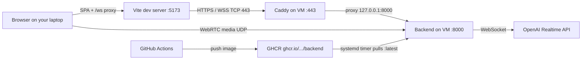

# Voice Chat (WebRTC + OpenAI Realtime)

A minimal voice chat app:

- **Frontend** (React + Vite): captures your microphone and streams it to the
  backend over **WebRTC**, then plays the model's spoken reply.
- **Backend** (FastAPI + aiortc): acts as the WebRTC peer, bridges audio to the
  **OpenAI Realtime API** over WebSocket (`gpt-realtime-mini` by default), and
  relays transcripts back to the browser.

```
Browser mic ──WebRTC(Opus 48kHz)──▶ aiortc ──PCM16 24kHz──▶ OpenAI Realtime
Browser spk ◀─WebRTC(Opus 48kHz)── aiortc ◀─PCM16 24kHz── OpenAI Realtime
```

## Deployment model

Only the **backend** is deployed to a cloud VM. The **frontend** runs locally on
your machine and connects to that remote backend.



- **GitHub Actions** builds the backend Docker image and pushes it to **GHCR**
  (`.github/workflows/build-backend.yml`).
- **Terraform** provisions the VM and installs Docker plus an **auto-update
  systemd timer** that pulls the latest image on a schedule.
- The local frontend's Vite dev server proxies `/ws` (signaling) and `/health`
  to the VM through **Caddy** (TLS-terminated on `:443`), so the browser only
  ever talks to `localhost` (a secure context required for `getUserMedia`).

## Prerequisites

- A GitHub repo where GitHub Actions can run.
- An OpenAI API key with Realtime access.
- [Terraform](https://developer.hashicorp.com/terraform/downloads) ≥ 1.5.
- [Azure CLI](https://learn.microsoft.com/cli/azure/install-azure-cli) and an
  Azure subscription.
- An SSH key pair (used to log into the VM).
- Node.js 18+ (for the local frontend only).

---

## Step 1 — Build & push the backend image (GitHub Actions)

The workflow [.github/workflows/build-backend.yml](.github/workflows/build-backend.yml)
builds [backend/Dockerfile](backend/Dockerfile) and pushes it to
`ghcr.io/trungaero/fcm-robot-light/backend`.

1. Push to `main` (or run the workflow manually from the **Actions** tab):
   ```bash
   git push origin main
   ```
2. The workflow tags the image as `latest` on the default branch, plus
   `sha-<short>`, the branch name, and any `v*` tag.

> **Package visibility.** By default GHCR packages are private. The VM must be
> able to pull the image without credentials, so make it **public**:
> GitHub → your repo → **Packages** → `fcm-robot-light/backend` → **Package
> settings** → *Change visibility* → **Public**.
>
> (Alternative: keep it private and store a GitHub PAT on the VM — see the
> note in Step 2.)

---

## Step 2 — Deploy the backend to an Azure VM (Terraform)

Terraform provisions one Ubuntu VM and installs Docker + the backend container.
It also installs an auto-update timer (see *Auto-update* below).

1. Log in to Azure:
   ```bash
   az login
   ```
2. Configure the variables:
   ```bash
   cd terraform
   cp terraform.tfvars.example terraform.tfvars
   ```
   Edit `terraform.tfvars`:
   - `ssh_public_key` — absolute path to your public key
     (e.g. `/home/you/.ssh/id_rsa.pub`; Terraform's `file()` does not expand `~`).
   - `openai_api_key` — your OpenAI key.
   - Optionally override `location`, `vm_size`, model/voice, or TURN settings.
3. Initialize and apply:
   ```bash
   terraform init
   terraform plan
   terraform apply
   ```
   State is kept locally (see [terraform/README.md](terraform/README.md) for
   remote-state options).
4. Get the connection details:
   ```bash
   terraform output
   ```
   - `public_ip`
   - `backend_url` → `https://<public_ip>`
   - `backend_ws_url` → `wss://<public_ip>`
   - `health_url` → `https://<public_ip>/health`
   - `ssh_command`
5. Verify the backend is up (Caddy's cert is self-signed, hence `-k`):
   ```bash
   curl -kfsS https://<public_ip>/health
   # {"status":"ok","model":"gpt-realtime-mini","api_key_configured":true}
   ```

> **Private GHCR packages.** If you kept the package private, SSH into the VM
> once and log Docker into GHCR with a PAT that has `read:packages` scope:
> ```bash
> ssh <admin>@<public_ip>
> echo '<PAT>' | sudo docker login ghcr.io -u <github-username> --password-stdin
> sudo docker compose -f /opt/voice-chat/docker-compose.yml pull
> sudo docker compose -f /opt/voice-chat/docker-compose.yml up -d
> ```

---

## Step 3 — Run the frontend locally

1. Point the dev server at the remote backend:
   ```bash
   cd frontend
   cp .env.example .env
   ```
   Edit `frontend/.env`:
   ```bash
   VITE_BACKEND_WS_URL=wss://<public_ip>
   VITE_BACKEND_HTTP_URL=https://<public_ip>
   ```
2. Install and start:
   ```bash
   npm install
   npm run dev
   ```
3. Open http://localhost:5173, click **Start talking**, allow the microphone,
   and speak.

The Vite dev server proxies `/ws` and `/health` to the VM over TLS (TCP 443,
Caddy-terminated, self-signed — accepted via `secure: false` in
[frontend/vite.config.ts](frontend/vite.config.ts)). WebRTC media flows
directly between your browser and the VM over UDP — see *Networking* below for
the TURN caveat.

---

## Auto-update: the VM pulls new images automatically

When you push a new backend image, the VM updates itself without any manual
step:

- cloud-init writes a systemd timer, `voice-chat-update.timer`, to
  `/etc/systemd/system/`.
- Every **2 minutes** it runs
  `docker compose pull && docker compose up -d --remove-orphans` in
  `/opt/voice-chat`, which re-creates the container only when `:latest`
  changed.

Useful commands on the VM:

```bash
systemctl status voice-chat-update.timer   # next scheduled run
systemctl list-timers voice-chat-update.*  # schedule overview
journalctl -u voice-chat-update.service    # pull logs
```

To pull immediately (without waiting for the timer):

```bash
ssh <admin>@<public_ip> \
  'sudo docker compose -f /opt/voice-chat/docker-compose.yml pull && \
   sudo docker compose -f /opt/voice-chat/docker-compose.yml up -d --remove-orphans'
```

> The poll interval is configured in
> [terraform/templates/cloud-init.yaml.tpl](terraform/templates/cloud-init.yaml.tpl)
> (`OnBootSec` / `OnUnitActiveSec`). For instant deploys you could instead add a
> CI step that SSHs into the VM and triggers a pull.

---

## Configuration

Backend settings come from environment variables. **On the VM** they are set via
`terraform.tfvars` → cloud-init → `/opt/voice-chat/.env`. **Locally** they come
from `backend/.env` (see [backend/.env.example](backend/.env.example)).

| Variable | Default | Purpose |
| --- | --- | --- |
| `OPENAI_API_KEY` | — | Required. |
| `OPENAI_REALTIME_MODEL` | `gpt-realtime-mini` | Try `gpt-realtime-2.1` for higher quality. |
| `OPENAI_REALTIME_VOICE` | `marin` | Output voice. |
| `OPENAI_INSTRUCTIONS` | friendly assistant | System prompt. |
| `OPENAI_SAFETY_IDENTIFIER` | `voice-chat-demo` | Privacy-preserving end-user id. |
| `BACKEND_HOST` / `BACKEND_PORT` | `0.0.0.0` / `8000` | Bind address (VM uses host network). |
| `WEBRTC_STUN_URL` | `stun:stun.l.google.com:19302` | STUN server. |
| `WEBRTC_TURN_URL` | — | Optional TURN server (recommended). |
| `WEBRTC_TURN_USERNAME` / `WEBRTC_TURN_CREDENTIAL` | — | TURN credentials. |

Frontend proxy settings are in `frontend/.env` (see
[frontend/.env.example](frontend/.env.example)):

| Variable | Default | Purpose |
| --- | --- | --- |
| `VITE_BACKEND_WS_URL` | `ws://localhost:8000` | `/ws` proxy target. |
| `VITE_BACKEND_HTTP_URL` | `http://localhost:8000` | `/health` proxy target. |

---

## Networking & production notes

- **Signaling** (`/ws`, `/health`) goes over TCP 443, TLS-terminated by Caddy
  on the VM and opened by the `HTTPS` NSG rule in
  [terraform/network.tf](terraform/network.tf). The backend's plain `:8000` is
  no longer exposed publicly.
- **WebRTC media** (SRTP/UDP) flows directly between the browser and the VM.
  aiortc binds ephemeral UDP ports, and the NSG opens the `40000–40100` range as
  a best-effort starting point. For reliable media behind NAT (especially
  symmetric NAT), run a **TURN** server and set `WEBRTC_TURN_URL`,
  `WEBRTC_TURN_USERNAME`, and `WEBRTC_TURN_CREDENTIAL` in `terraform.tfvars`.
- **TLS** is provided by Caddy on the VM using a self-signed certificate for
  the VM's public IP. The browser itself only talks to `localhost` (a secure
  context); the Vite dev proxy accepts the self-signed cert. To use a trusted
  cert instead, point a domain at the VM and switch the Caddyfile site address
  from the IP to that domain so Caddy can obtain a Let's Encrypt certificate.

---

## Local development (both services on one machine)

No VM needed if you just want to hack locally:

```bash
# Terminal 1 — backend
cd backend
python -m venv .venv && source .venv/bin/activate
pip install -r requirements.txt
cp .env.example .env            # set OPENAI_API_KEY
uvicorn main:app --reload --port 8000

# Terminal 2 — frontend (defaults proxy to localhost:8000)
cd frontend
npm install
npm run dev
```

Open http://localhost:5173. On Linux, aiortc needs system libs for the
non-Docker path: `sudo apt install libsrtp2-dev ffmpeg`.

---

## How it works

- [backend/audio.py](backend/audio.py) resamples WebRTC audio (48 kHz) to the
  Realtime API's PCM16 24 kHz and back.
- [backend/openai_realtime.py](backend/openai_realtime.py) is a small async
  client for the Realtime WebSocket, exposing audio chunks, transcripts, and
  turn boundaries.
- [backend/rtc.py](backend/rtc.py) owns the `RTCPeerConnection`: it sends mic
  audio to OpenAI and plays model audio back through a paced
  `AudioStreamTrack`.
- [backend/main.py](backend/main.py) handles SDP/ICE signaling over `/ws`.
- [frontend/src/voiceChat.ts](frontend/src/voiceChat.ts) does the browser side
  of WebRTC + signaling.
